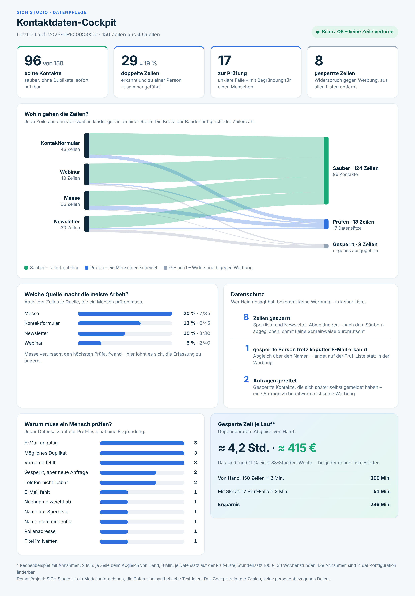
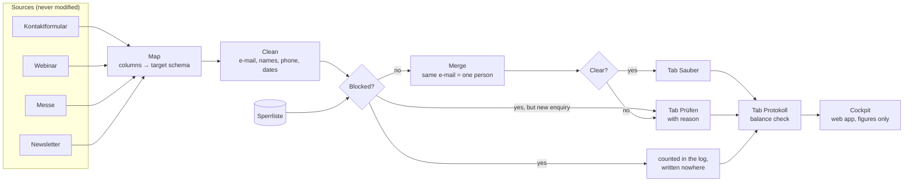

# Kontaktlisten-Bereinigung — contact list clean-up in Google Sheets

**One click in Google Sheets turns 150 messy rows from four sources into 96 clean contacts, a review list with a reason for every open case, and a management cockpit. People who objected to advertising appear in neither list.**

Built with Google Apps Script. No add-ons, no external services, no AI in the core: every rule can be read, tested and explained.

**Live cockpit:** [open the web app](https://script.google.com/macros/s/AKfycbxigPIFfsmDxaRsgpY2GTBQPTFU-wtq3qKxddGltTRqq5-TF2dZNikwP52lejOiaifE/exec) – figures of the last run, no personal data.

**Status: active.** The project runs in a real Google Sheet and is being extended. What is planned next is listed under [Status and next steps](#status-and-next-steps).



> Demo project: SICH Studio is a model company. All people, companies, e-mail addresses and phone numbers are synthetic test data, and every domain ends in `.example`, which does not exist on the internet. The interface and the specification are in German, the language of the target users.

---

## The problem

SICH Studio, a small consultancy, collects contacts in four ways. Each list is kept by a different person or tool:

| Source | Rows | Typical damage |
|---|---|---|
| **Kontaktformular** (website export) | 45 | upper/lower case, trailing spaces, invisible characters from copy and paste, double submissions |
| **Webinar** (registration tool) | 40 | full name in one cell (`Seidel, Bettina`), dates as real dates or as Excel numbers |
| **Messe** (business cards, typed in) | 35 | typos, `(at)` instead of `@`, missing e-mail, `ue` instead of `ü`, shortened company names |
| **Newsletter** (tool export) | 30 | only e-mail and first name, status `abgemeldet` |

On top comes a **Sperrliste**: people who objected to the use of their data for advertising (Art. 21 GDPR).

The goal: write to nobody twice, and to nobody who said no.

## The result

| | |
|---|---|
| Rows read | **150** |
| Clean contacts, one per person | **96** |
| Duplicate rows merged | **29** (19 %) |
| Records for a human to decide, each with a reason | **17** |
| Blocked rows, written nowhere | **8** |
| Balance check | **OK**: 150 = 124 + 18 + 8, no row lost |

The rule behind every decision: **the machine cleans, a human decides.**

## How it works



The mapping from source columns to the target schema is **configuration, not code** ([`src/Konfiguration.gs`](src/Konfiguration.gs)). A new source is one more entry.

### What the machine fixes

| Rule | Example |
|---|---|
| Remove invisible characters (zero-width space, soft hyphen, direction marks) | `katrin` + zero-width space + `@…` and `katrin@…` become the same person |
| Trim, collapse double spaces, lower-case the e-mail | `J.NEUMANN@…` → `j.neumann@…` |
| Fix names that are all upper or all lower case | `PETRA  SCHMITT` → `Petra Schmitt` |
| Split a name from one cell | `Seidel, Bettina` → Bettina / Seidel · `Henrik von der Heide` → Henrik / von der Heide |
| Phone numbers to E.164 | `030/2312…`, `0049 30 …`, `+49 (0)30 …` → `+4930…` |
| Dates to `YYYY-MM-DD` | `8.10.26`, `08.10.2026 14:30`, a date cell, the Excel number `46280` |
| Merge rows with the same e-mail and fill gaps from other sources | form + trade fair → one record, the more reliable source wins |

### What a human decides

A record goes to **Prüfen** with a plain reason. The script never guesses.

| Reason | Why the machine stops |
|---|---|
| `E-Mail ungültig` | `tobias.engel(at)…` could be repaired, but a wrong guess sends mail to a stranger |
| `Name nicht eindeutig` | `Anna Lena Vogt`: double first name or double surname? |
| `Nachname weicht ab` | same e-mail, `Krüger` and `Neumann`. `Möller` and `Moeller` do **not** count as a conflict |
| `Gleiche E-Mail, verschiedene Vornamen` | one address for two people. Both records are kept, nobody disappears |
| `Mögliches Duplikat zu …` | same name and company, different e-mail |
| `Telefon nicht lesbar` | `040 / 12`, `siehe Website` |
| `Rollenadresse` | `info@…` has no contact person |
| `Name auf Sperrliste` | the blocked person's e-mail is broken in one source, the name still matches |
| `Gesperrt, aber neue Anfrage` | someone objected to advertising and later sent an enquiry. Answering an enquiry is not advertising, so it must not vanish |

## Details that decide whether the result is right

- **`+49 (0)30 …` and `+49 030 …`.** The usual one-line expression (strip everything but digits, turn a leading `0` into `+49`) produces `+49030…`, a number that looks tidy and does not connect. The script removes the optional zero first and then checks the length.
- **Google Sheets rewrites values.** Written into a normal cell, `+4930…` loses its plus and becomes a number, and `2026-09-15` becomes a date. The script sets the text format first and writes the values second.
- **Block after cleaning, not before.** Compared raw, `MARKUS…@` slips past `markus…@` on the block list.
- **Why merge before review?** The tool reviews records, not rows: a missing first name in one source is often filled from another, and some conflicts, such as different surnames or two people behind one address, only show once the rows of one person are grouped. Rows without a valid e-mail never enter the merge, so they cannot be swallowed as duplicates.
- **A missing block list stops the run.** Without it, every blocked person would land in the clean list while the balance still says OK.
- **Count the rows.** Each run writes a log line and checks `read = clean + review + blocked`. In 2020 Public Health England lost 15,841 COVID cases because a file format cut rows off without an error. A balance would have shown it at once.

## The rules in code

Seven rules as they appear in the script. Variable names are simplified for reading; the full code is in [`src/Bereinigung.gs`](src/Bereinigung.gs) and [`src/Code.gs`](src/Code.gs).

**Invisible characters**

```js
text.replace(/[\u00AD\u200B-\u200F\u2060\uFEFF]/g, '')   // zero-width space, soft hyphen, direction marks
    .replace(/[\u00A0\u2007\u202F]/g, ' ')               // non-breaking spaces
    .replace(/\s+/g, ' ')
    .trim()
```

These characters cannot be seen and arrive through copy and paste. Without this line, two identical e-mail addresses count as different.

**Valid e-mail**

```js
/^[a-z0-9._%+-]+@[a-z0-9-]+(\.[a-z0-9-]+)*\.[a-z]{2,}$/.test(email)
```

"Contains an @" is not enough. The rule also requires a domain with an ending; otherwise the row goes to review.

**Phone: the one-liner and the script**

```js
// The usual one-liner, here as an n8n expression. It turns "+49 (0)30 …" into a wrong "+49030…".
{{ $json.telefon.replace(/[^0-9+]/g, '').replace(/^00/, '+').replace(/^0/, '+49') }}

// In the script (shortened)
var t = text.replace(/\(0\)/g, '').replace(/[^0-9+]/g, '');      // remove "(0)" first
if (nummer.indexOf('490') === 0) nummer = '49' + nummer.slice(3); // "+49 030 …" → "+4930…"
if (nummer.length < 10 || nummer.length > 15) { /* → review: "Telefon nicht lesbar" */ }
```

The one-liner makes a number look tidy. The script also checks whether the result can be a phone number.

**Compare without changing**

```js
text.toLowerCase()
    .replace(/ä/g, 'ae').replace(/ö/g, 'oe').replace(/ü/g, 'ue').replace(/ß/g, 'ss')
    .normalize('NFD').replace(/[\u0300-\u036f]/g, '')            // é → e
```

"Möller" and "Moeller" are equal for comparison. The stored name keeps the spelling of the most reliable source.

**Excel number as a date**

```js
new Date(Date.UTC(1899, 11, 30) + Math.floor(wert) * 86400000)   // 46280 → 2026-09-15
```

Old exports often store a date as a number: the days since 30 December 1899.

**Text format first, values second**

```js
bereich.setNumberFormat('@');   // plain text
bereich.setValues(daten);
```

The other way round, Google Sheets turns "+4930…" into a number without the plus.

**Balance**

```js
bilanzOk = gelesen === sauberZeilen + pruefenZeilen + gesperrt;
```

One line that shows after every run whether anything was lost.

## Privacy by design

- Blocked rows are removed from **all** sources and written to no tab. Only their number appears in the log.
- The cockpit reads stored key figures, never the spreadsheet. It contains no names and no addresses, so the link can be shared.
- The manifest limits the script to **this one spreadsheet** (`spreadsheets.currentonly`) instead of all files in the Drive.
- Text from a public form that starts with `=` is written as text and can never run as a formula.
- Columns that are not needed (message, note, attendance) are not carried over.

## The cockpit

`Datenpflege → Cockpit anzeigen` opens the dashboard inside the spreadsheet. Deployed as a web app (`Bereitstellen → Web-App`), the same page has its own link: **[live cockpit](https://script.google.com/macros/s/AKfycbxigPIFfsmDxaRsgpY2GTBQPTFU-wtq3qKxddGltTRqq5-TF2dZNikwP52lejOiaifE/exec)**. It shows the figures of the last run:

- key figures and balance status
- the flow of rows from each source to *Sauber*, *Prüfen* and *Gesperrt*
- the share of rows per source that needs a human. Trade-fair cards cause the most work (20 %)
- data protection: blocked rows, the blocked person caught by name, enquiries saved
- reasons on the review list
- **time saved per run**, as a worked example

The time figure rests on stated assumptions, shown in the footnote and set in the configuration: 2 minutes per row by hand, 3 minutes per remaining review case, 100 € per hour, a 38-hour week. They are assumptions, not measurements.

## Tests

The rules live in pure functions without any Google service ([`src/Bereinigung.gs`](src/Bereinigung.gs)), so they run locally in Node.

```bash
python3 tests/export_fixture.py   # workbook → tests/fixture.json
node tests/run-tests.js           # 128 checks: building blocks, 23 special cases, balance, second run
node tests/smoke-sheets.js        # menu, tabs, log and cockpit against a simulated SpreadsheetApp
```

The test data ([`daten/sich-studio-quelldaten.xlsx`](daten/sich-studio-quelldaten.xlsx)) is generated with a fixed seed by [`tools/generate_testdaten.py`](tools/generate_testdaten.py). It contains 23 deliberately placed special cases, each with an expected outcome in [`tests/sonderfaelle.json`](tests/sonderfaelle.json).

## Set it up

1. Open `sheets.new`, then `Datei → Importieren → Hochladen`, choose `daten/sich-studio-quelldaten.xlsx` and select *Tabelle ersetzen*.
2. `Erweiterungen → Apps Script`. Create the script files `Konfiguration`, `Bereinigung`, `Code` and the HTML file `Dashboard`, and paste the contents from [`src/`](src).
3. In the project settings, show `appsscript.json` in the editor and paste [`src/appsscript.json`](src/appsscript.json).
4. Reload the spreadsheet and run `Datenpflege → Kontaktlisten bereinigen`. Confirm the permissions once.
5. `Datenpflege → Cockpit anzeigen`.

Expected log line: `150 | 8 | 96 | 17 | 29 | OK`.

## Repository

```
src/        Konfiguration.gs  column mapping, priorities, lists, cockpit assumptions
            Bereinigung.gs    the rules, pure functions
            Code.gs           menu, reading and writing, log, cockpit, daily trigger
            Dashboard.html    the cockpit page
            appsscript.json   time zone and minimal permissions
daten/      test workbook: 4 sources and the block list
docs/       specification (German), screenshots
tests/      local tests and expected outcomes
tools/      test data generator
```

The full set of rules is in [`docs/spezifikation.md`](docs/spezifikation.md).

## How it was built — and my role

I am training as an *AI Manager / process automation* specialist (Make, n8n, BPMN). The starting point was a course exercise on cleaning 18 rows with n8n. I rebuilt the idea in Apps Script with my own data, stricter rules and a view for management.

I worked with **Claude (Anthropic) as the developer**. Claude wrote the code and the tests. I owned the scope, the business rules, the acceptance and the presentation. In practice that meant:

**Scope and set-up**

- I chose the topic and the tool: data cleaning with Apps Script, as a portfolio project that can be published.
- I decided to work with a model company and synthetic data instead of the course data, so the project can be published.
- I set the size. The first proposal was 60 rows; I asked for at least 150 so that duplicates and edge cases appear in realistic numbers.
- I defined the model company: a consultancy for automation services.

**Acceptance in the real spreadsheet**

- I installed every version in Google Sheets myself and ran it from the menu, the way an employee without access to the code would.
- The first run stopped with `Invalid argument: timeZone`. I reported the exact message; the cause was an imported spreadsheet without a time zone, a case the local simulation had not covered.
- I compared each log line with the expected figures and checked single records against their source rows. One phone number looked wrong to me, so I had it traced back to the source row before accepting the result.

**Quality**

- While working through the n8n exercise I noticed that the phone column in the "clean" list was still untidy, and asked what the usual one-line fix does to `+49 (0)30 …` in real use. The answer is documented under *Details that decide whether the result is right*.
- I asked for a critical review of the finished script. It found ten defects outside the test data, among them the missing block list and `+49 030 …`. All are fixed and covered by tests.
- I introduced version numbers for every delivered file, after several changed files had arrived under the same name on one day.

**Business rules**

- A blocked person who later sends an enquiry goes to review instead of vanishing. Answering an enquiry is not advertising.
- Two people behind one e-mail address are both kept.
- I asked how two freelancers with the same name are handled. The cautious rule stays for now: both go to review.

**Management view**

- I asked for a dashboard that a managing director can read, and defined the audience and the look: light, modern, white, blue and green.
- I chose a web app in Apps Script over a chart tab in Sheets, approved the blocks and left out the run history for now.
- I added the time saved as a worked example: an owner working 38 hours a week at 100 € per hour, with the assumptions shown in a footnote.

**Operation**

- I asked what happens when rows are added or a new trade fair comes in. The answers are now part of this README, including the limit that review decisions are not remembered yet.

## Working with it day to day

- **New rows:** append them at the bottom of the existing source tabs and run the menu item again. Every run reads all sources and rewrites *Sauber* and *Prüfen* completely.
- **A new trade fair:** append to the tab *Messe*, or add a new tab and one entry in `Konfiguration.gs` if the columns differ or the fair should appear as its own source in the cockpit.
- **Corrections belong in the source tabs.** A value fixed directly in *Sauber* or *Prüfen* is overwritten by the next run. Fix the source row and run again; the record then moves from *Prüfen* to *Sauber* by itself.
- **Do not sort or delete rows inside a source tab.** The column `quellen` refers to row numbers such as `Messe-12`.
- **The block list only grows.** A new objection is a new row. If the tab is missing, the run stops.

## Limits

- **Review decisions are tied to row numbers.** Decisions are matched by the `quellen` column (tab + row number). If rows are inserted, deleted or re-sorted in a source tab, the decision cannot be matched and moves to the tab *Entscheidungen-Archiv*. It is kept, but has to be re-assigned by hand.
- The rules are written for German names, phone numbers and date formats.
- The time saved is a worked example based on assumptions.
- The script produces lists. It sends no e-mail and writes to no CRM.
- Two freelancers with the same name and no company both go to review. That is cautious and costs manual work on large lists.
- Tested in Google Sheets with 150 rows. The rules themselves process 15,000 rows in about half a second in the local test; the run time in Sheets for large lists has not been measured yet.

## Status and next steps

The project is active and still being improved. Planned next:

- measure the run time in Google Sheets with several thousand rows
- a copy link to the spreadsheet, so anyone can try it with one click

### Changelog

- **2026-11-11** Review decisions are kept between runs (columns `entscheidung` and `notiz` on *Prüfen*, unmatched decisions go to *Entscheidungen-Archiv*). New tab *Kontrolle*: spreadsheet formulas recount the result independently of the script. The cell that triggers a review reason is highlighted.
- **2026-11-10** Cockpit as web app (published) and menu item. Two new rules: enquiry after an objection, two people behind one address. Code review with ten fixes. First run in Google Sheets.
- **2026-11-09** Specification, synthetic test data (150 rows, 23 special cases) and expected outcomes.

## License

[MIT](LICENSE) © 2026 Dariia Sichynska
