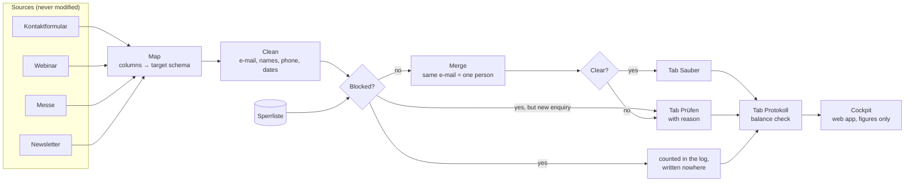

# Kontaktlisten-Bereinigung — contact list clean-up in Google Sheets

**With one click in Google Sheets, 150 messy rows from four sources are turned into 96 clean contacts, a review list with a reason for every open case, and a management cockpit. People who objected to advertising appear in neither list.**

The project is built with Google Apps Script. No add-ons, no external services and no AI are used in the core, so every rule can be read, tested and explained.

**Live cockpit:** [open the web app](https://script.google.com/macros/s/AKfycbxigPIFfsmDxaRsgpY2GTBQPTFU-wtq3qKxddGltTRqq5-TF2dZNikwP52lejOiaifE/exec). The figures of the last run are shown; no personal data is included.

**Status: active.** The project is run in a real Google Sheet and is being extended. Planned steps are listed under [Status and next steps](#status-and-next-steps).


> Demo project: SICH Studio is a model company. All people, companies, e-mail addresses and phone numbers are synthetic test data, and every domain ends in `.example`, which does not exist on the internet. The interface and the specification are written in German, the language of the target users.

---

## The problem

At SICH Studio, a small consultancy, contacts are collected in four ways. Each list is kept by a different person or tool:

| Source | Rows | Typical damage |
|---|---|---|
| **Kontaktformular** (website export) | 45 | upper/lower case, trailing spaces, invisible characters from copy and paste, double submissions |
| **Webinar** (registration tool) | 40 | full name in one cell (`Seidel, Bettina`), dates as real dates or as Excel numbers |
| **Messe** (business cards, typed in) | 35 | typos, `(at)` instead of `@`, missing e-mail, `ue` instead of `ü`, shortened company names |
| **Newsletter** (tool export) | 30 | only e-mail and first name, status `abgemeldet` |

In addition, a **Sperrliste** (block list) is kept for people who objected to the use of their data for advertising (Art. 21 GDPR).

The goal is that nobody is contacted twice and that nobody who objected is contacted at all.

## The result

| | |
|---|---|
| Rows read | **150** |
| Clean contacts, one per person | **96** |
| Duplicate rows merged | **29** (19 %) |
| Records for a human to decide, each with a reason | **17** |
| Blocked rows, written nowhere | **8** |
| Balance check | **OK**: 150 = 124 + 18 + 8, no row lost |

Every decision follows one rule: **the data is cleaned by the machine, open cases are decided by a human.**

## How it works



The mapping from source columns to the target schema is kept as **configuration, not code** ([`src/Konfiguration.gs`](src/Konfiguration.gs)). A new source is added as one more entry.

### What is fixed automatically

| Rule | Example |
|---|---|
| Invisible characters are removed (zero-width space, soft hyphen, direction marks) | `katrin` + zero-width space + `@…` and `katrin@…` are recognised as the same person |
| Spaces are trimmed and collapsed, the e-mail is lower-cased | `J.NEUMANN@…` → `j.neumann@…` |
| Names in all upper or all lower case are corrected | `PETRA  SCHMITT` → `Petra Schmitt` |
| A name in one cell is split | `Seidel, Bettina` → Bettina / Seidel · `Henrik von der Heide` → Henrik / von der Heide |
| Phone numbers are converted to E.164 | `030/2312…`, `0049 30 …`, `+49 (0)30 …` → `+4930…` |
| Dates are converted to `YYYY-MM-DD` | `8.10.26`, `08.10.2026 14:30`, a date cell, the Excel number `46280` |
| Rows with the same e-mail are merged, gaps are filled from other sources | form + trade fair → one record; the more reliable source is preferred |

### What is decided by a human

A record is moved to **Prüfen** with a plain reason. No value is guessed.

| Reason | Why the record is not decided automatically |
|---|---|
| `E-Mail ungültig` | `tobias.engel(at)…` could be repaired, but a wrong guess would send mail to a stranger. |
| `Name nicht eindeutig` | For `Anna Lena Vogt`, a double first name and a double surname are both possible. |
| `Nachname weicht ab` | The same e-mail is used with `Krüger` and `Neumann`. `Möller` and `Moeller` are **not** treated as a conflict. |
| `Gleiche E-Mail, verschiedene Vornamen` | One address is used by two people. Both records are kept. |
| `Mögliches Duplikat zu …` | The same name and company are found with a different e-mail. |
| `Telefon nicht lesbar` | Values such as `040 / 12` or `siehe Website` cannot be converted. |
| `Rollenadresse` | No contact person is known for `info@…`. |
| `Name auf Sperrliste` | The e-mail of a blocked person is broken in one source, but the name still matches. |
| `Gesperrt, aber neue Anfrage` | An objection to advertising was followed by an enquiry. Answering an enquiry is not advertising, so the record must not be dropped. |

## Details that decide whether the result is right

- **`+49 (0)30 …` and `+49 030 …`.** With the usual one-line expression (all non-digits are stripped, a leading `0` is replaced by `+49`), `+49030…` is produced. The number looks tidy but cannot be reached. In the script, the optional zero is removed first and the length is checked afterwards.
- **Values are rewritten by Google Sheets.** In a normal cell, the plus is dropped from `+4930…` and `2026-09-15` is converted to a date. Therefore the text format is set first and the values are written second.
- **Blocking is done after cleaning.** In a raw comparison, `MARKUS…@` would not be matched with `markus…@` on the block list.
- **Records are merged before they are reviewed.** Records are reviewed, not rows. A missing first name in one source is often filled from another, and some conflicts, such as different surnames or two people behind one address, become visible only when the rows of one person are grouped. Rows without a valid e-mail are never merged, so they cannot disappear as duplicates.
- **The run is stopped if the block list is missing.** Otherwise every blocked person would be written to the clean list while the balance still showed OK.
- **The rows are counted.** A log line is written after each run, and `read = clean + review + blocked` is checked. In 2020, 15,841 COVID cases were lost by Public Health England because rows were cut off by a file format without an error. With a balance check, the loss would have been shown at once.

## The rules in code

Seven rules are shown as they appear in the script. Variable names are simplified; the full code is found in [`src/Bereinigung.gs`](src/Bereinigung.gs) and [`src/Code.gs`](src/Code.gs).

**Invisible characters**

```js
text.replace(/[­​-‏⁠]/g, '')   // zero-width space, soft hyphen, direction marks
    .replace(/[   ]/g, ' ')               // non-breaking spaces
    .replace(/\s+/g, ' ')
    .trim()
```

These characters cannot be seen and are introduced through copy and paste. Without this line, two identical e-mail addresses would be counted as different.

**Valid e-mail**

```js
/^[a-z0-9._%+-]+@[a-z0-9-]+(\.[a-z0-9-]+)*\.[a-z]{2,}$/.test(email)
```

An `@` alone is not sufficient. A domain with an ending is also required; otherwise the row is sent to review.

**Phone: the one-liner and the script**

```js
// The usual one-liner, here as an n8n expression. "+49 (0)30 …" is turned into a wrong "+49030…".
{{ $json.telefon.replace(/[^0-9+]/g, '').replace(/^00/, '+').replace(/^0/, '+49') }}

// In the script (shortened)
var t = text.replace(/\(0\)/g, '').replace(/[^0-9+]/g, '');      // "(0)" is removed first
if (nummer.indexOf('490') === 0) nummer = '49' + nummer.slice(3); // "+49 030 …" → "+4930…"
if (nummer.length < 10 || nummer.length > 15) { /* → review: "Telefon nicht lesbar" */ }
```

With the one-liner, a number only looks tidy. In the script, it is also checked whether the result can be a phone number.

**Comparison without changing the value**

```js
text.toLowerCase()
    .replace(/ä/g, 'ae').replace(/ö/g, 'oe').replace(/ü/g, 'ue').replace(/ß/g, 'ss')
    .normalize('NFD').replace(/[̀-ͯ]/g, '')            // é → e
```

"Möller" and "Moeller" are treated as equal in the comparison. The name is stored as it is spelled in the most reliable source.

**Excel number as a date**

```js
new Date(Date.UTC(1899, 11, 30) + Math.floor(wert) * 86400000)   // 46280 → 2026-09-15
```

In old exports, a date is often stored as a number: the days since 30 December 1899.

**Text format first, values second**

```js
bereich.setNumberFormat('@');   // plain text
bereich.setValues(daten);
```

In the opposite order, "+4930…" is converted by Google Sheets into a number without the plus.

**Balance**

```js
bilanzOk = gelesen === sauberZeilen + pruefenZeilen + gesperrt;
```

With this line, it is shown after every run whether any row was lost.

## Privacy by design

- Blocked rows are removed from **all** sources and are written to no tab. Only their number is shown in the log.
- Only stored key figures are read by the cockpit, never the spreadsheet. No names or addresses are contained, so the link can be shared.
- The script is limited by the manifest to **this one spreadsheet** (`spreadsheets.currentonly`) instead of all files in the Drive.
- Text from a public form that starts with `=` is written as text and is never executed as a formula.
- Columns that are not needed (message, note, attendance) are not carried over.

## The cockpit

The dashboard is opened inside the spreadsheet with `Datenpflege → Cockpit anzeigen`. When it is deployed as a web app (`Bereitstellen → Web-App`), the same page is available under its own link: **[live cockpit](https://script.google.com/macros/s/AKfycbxigPIFfsmDxaRsgpY2GTBQPTFU-wtq3qKxddGltTRqq5-TF2dZNikwP52lejOiaifE/exec)**. The figures of the last run are shown:

- key figures and balance status;
- the flow of rows from each source to *Sauber*, *Prüfen* and *Gesperrt*;
- the share of rows per source that needs a human decision (the most work is caused by trade-fair cards, 20 %);
- data protection: blocked rows, the blocked person caught by name, enquiries that were kept;
- reasons on the review list;
- **time saved per run**, as a worked example.

The time saved is calculated from stated assumptions, which are shown in the footnote and set in the configuration: 2 minutes per row by hand, 3 minutes per remaining review case, 100 € per hour, a 38-hour week. These values are assumptions, not measurements.

## Tests

The rules are kept in pure functions without any Google service ([`src/Bereinigung.gs`](src/Bereinigung.gs)), so they can be run locally in Node.

```bash
python3 tests/export_fixture.py   # workbook → tests/fixture.json
node tests/run-tests.js           # 128 checks: building blocks, 23 special cases, balance, second run
node tests/smoke-sheets.js        # menu, tabs, log and cockpit against a simulated SpreadsheetApp
```

The test data ([`daten/sich-studio-quelldaten.xlsx`](daten/sich-studio-quelldaten.xlsx)) is generated with a fixed seed by [`tools/generate_testdaten.py`](tools/generate_testdaten.py). It contains 23 deliberately placed special cases; the expected outcome of each case is defined in [`tests/sonderfaelle.json`](tests/sonderfaelle.json).

## Set-up

1. A new spreadsheet is created with `sheets.new`. Via `Datei → Importieren → Hochladen`, `daten/sich-studio-quelldaten.xlsx` is imported with the option *Tabelle ersetzen*.
2. Under `Erweiterungen → Apps Script`, the script files `Konfiguration`, `Bereinigung`, `Code` and the HTML file `Dashboard` are created, and the contents from [`src/`](src) are pasted in.
3. In the project settings, `appsscript.json` is shown in the editor and replaced with [`src/appsscript.json`](src/appsscript.json).
4. After the spreadsheet is reloaded, `Datenpflege → Kontaktlisten bereinigen` is run. The permissions are confirmed once.
5. The cockpit is opened with `Datenpflege → Cockpit anzeigen`.

Expected log line: `150 | 8 | 96 | 17 | 29 | OK`.

## Repository

```
src/        Konfiguration.gs  column mapping, priorities, lists, cockpit assumptions
            Bereinigung.gs    the rules, pure functions
            Code.gs           menu, reading and writing, log, cockpit, daily trigger
            Dashboard.html    the cockpit page
            appsscript.json   time zone and minimal permissions
daten/      test workbook: 4 sources and the block list
docs/       specification (German), screenshots
tests/      local tests and expected outcomes
tools/      test data generator
```

The full set of rules is described in [`docs/spezifikation.md`](docs/spezifikation.md).

## Project background

The project is based on a course exercise from a training programme in AI management and process automation, in which 18 rows were cleaned with n8n. The idea was rebuilt in Apps Script with synthetic data, stricter rules and a view for management.

Concept, business rules, acceptance and presentation: Dariia Sichynska.

Tools: Google Apps Script, Google Sheets, Node (tests), Claude (Anthropic).

**Scope**

- Data cleaning with Apps Script was chosen as the topic, so that the result can be published as a portfolio project.
- A model company (a consultancy for automation services) and synthetic data are used instead of the course data.
- At least 150 rows were required, so that duplicates and edge cases appear in realistic numbers.

**Acceptance in the real spreadsheet**

- Every version was installed in Google Sheets and run from the menu, as it would be run by an employee without access to the code.
- The first run was stopped with `Invalid argument: timeZone`. The cause was an imported spreadsheet without a time zone, a case that had not been covered by the local simulation.
- Each log line was compared with the expected figures, and single records were checked against their source rows. A phone number that looked wrong was traced back to its source row before the result was accepted.

**Quality**

- The usual one-line phone fix was checked against `+49 (0)30 …`; the result is documented under *Details that decide whether the result is right*.
- A critical review of the finished script was carried out. Ten defects outside the test data were found, among them the missing block list and `+49 030 …`. All defects are fixed and covered by tests.
- Version numbers were introduced for every delivered file.

**Business rules**

- A blocked person who later sends an enquiry is moved to review instead of being dropped, because answering an enquiry is not advertising.
- Two people behind one e-mail address are both kept.
- Two freelancers with the same name are both sent to review for now.

**Management view**

- The cockpit is written for a managing director: light, modern, in white, blue and green.
- A web app in Apps Script was chosen instead of a chart tab in Sheets. A run history is not included yet.
- The time saved is shown as a worked example for an owner with a 38-hour week at 100 € per hour; the assumptions are given in a footnote.

**Operation**

- The behaviour for added rows and a new trade-fair source was checked and is described under *Working with it day to day*. This led to v1.5, in which review decisions are kept between runs.

## Working with it day to day

- **New rows** are appended at the bottom of the existing source tabs, and the menu item is run again. All sources are read in every run, and *Sauber* and *Prüfen* are rewritten completely.
- **A new trade fair** is appended to the tab *Messe*. A new tab and one entry in `Konfiguration.gs` are needed only if the columns differ or the fair is to be shown as its own source in the cockpit.
- **Corrections are made in the source tabs.** A value that is fixed directly in *Sauber* or *Prüfen* is overwritten by the next run. After the source row is corrected and the run is repeated, the record is moved from *Prüfen* to *Sauber* automatically.
- **Rows inside a source tab are not sorted or deleted.** Row numbers such as `Messe-12` are referenced in the column `quellen`.
- **The block list is only extended.** A new objection is added as a new row. If the tab is missing, the run is stopped.

## Limits

- **Review decisions are tied to row numbers.** Decisions are matched by the column `quellen` (tab + row number). If rows are inserted, deleted or re-sorted in a source tab, the decision cannot be matched and is moved to the tab *Entscheidungen-Archiv*. It is kept there, but it has to be re-assigned by hand.
- The rules are written for German names, phone numbers and date formats.
- The time saved is a worked example based on assumptions.
- Only lists are produced. No e-mail is sent, and no data is written to a CRM.
- Two freelancers with the same name and no company are both sent to review. This is cautious and causes manual work on large lists.
- The project was tested in Google Sheets with 150 rows. In the local test, 15,000 rows are processed by the rules in about half a second; the run time in Sheets for large lists has not been measured yet.

## Status and next steps

The project is active and is still being improved. The next steps are planned:

- The run time in Google Sheets is to be measured with several thousand rows.
- A copy link to the spreadsheet is to be provided, so that the project can be tried with one click.

### Changelog

- **2026-11-13** README rewritten in an impersonal style; no change to the code.
- **2026-11-11** Review decisions are kept between runs (columns `entscheidung` and `notiz` on *Prüfen*; unmatched decisions are moved to *Entscheidungen-Archiv*). New tab *Kontrolle*: the result is recounted with spreadsheet formulas, independently of the script. The cell that triggers a review reason is highlighted.
- **2026-11-10** The cockpit is published as a web app and added as a menu item. Two new rules: an enquiry after an objection, two people behind one address. Ten defects fixed after a code review. First run in Google Sheets.
- **2026-11-09** Specification, synthetic test data (150 rows, 23 special cases) and expected outcomes created.

## License

[MIT](LICENSE) © 2026 Dariia Sichynska
